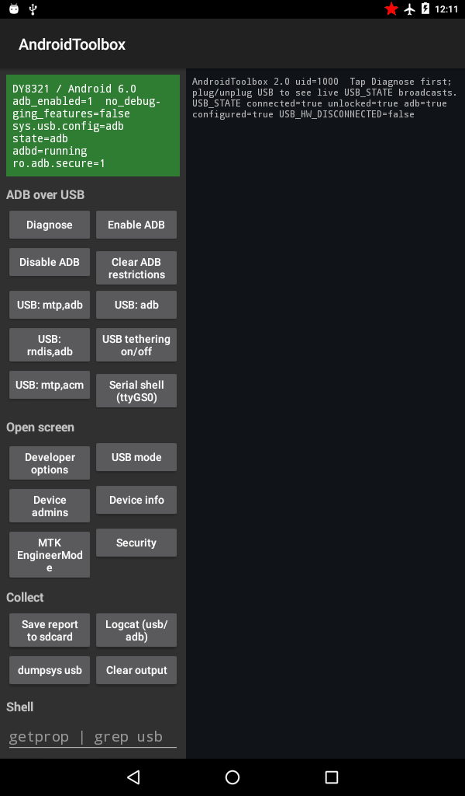

# Android Toolbox

Research toolbox for DPRK tablets (Ryongaksan 4.4, Taeyang 8321 / MTK 6.0): getting ADB over USB,
inspecting the restrictions that block it, and exporting evidence.



Running live on the Taeyang (DY8321, Android 6.0) after the boot.img repack described below: the
status banner confirms `adb_enabled=1`, `sys.usb.config=adb`, `adbd=running`.

## Why USB adb fails on Taeyang (DY8321, MT6580, 6.0)

From the 2018/19 dump (`reveal-tools/out/dump-validation/tablet-2018_2019-daeyang_taeyang_8321/work/extracted`):

- `/sbin/adbd` is **absent** from the boot *and* recovery ramdisks (raw cpio checked). `init.rc` still
  declares `service adbd /sbin/adbd`, and `init.mt6580.usb.rc` has every `*,adb` USB config, so
  enabling adb switches the gadget to `mtp,adb` and `start adbd` then fails silently.
- The SELinux side was removed too: no `/sbin/adbd` entry in `file_contexts`, no `adbd_exec` type in
  `sepolicy`. `ro.adb.secure=1`, `ro.debuggable=0`, `persist.sys.usb.config=mtp`.
- Settings/SystemUI/SettingsProvider are stock MTK 6.0. One trap: a `no_debugging_features` user
  restriction makes SettingsProvider drop `adb_enabled` writes without an error.

So no toggle can make USB adb work on this image. The options are:

1. **Repack boot.img** (needs a flashing path, e.g. SP Flash Tool): add an arm 6.0 `/sbin/adbd`,
   a `/sbin/adbd u:object_r:adbd_exec:s0` file context *and* a sepolicy that defines `adbd_exec`
   with an entrypoint into `adbd`. Optionally set `ro.adb.secure=0` and `ro.debuggable=1` in `default.prop`.
2. **Serial shell without reflashing**: build the `system` flavor, sign with the AOSP platform key, tap
   **USB: mtp,acm** then **Serial shell (ttyGS0)**, and on the Mac run `screen /dev/cu.usbmodem* 115200`.
   This gives a uid-1000 shell over the cable. Untested on hardware: SELinux may deny `system_app` on
   `ttyGS_device`, and the app will report it if so.

## Install

Most actions need signature|privileged permissions (WRITE_SECURE_SETTINGS, MANAGE_USB, MANAGE_USERS,
READ_LOGS, DUMP). Two flavors:

- `system`: `sharedUserId=android.uid.system`. Sign it with the platform key. Ryongaksan and Taeyang use the
  public AOSP test key (SF-19), so use `apksigner sign --key platform.pk8 --cert platform.x509.pem`
  with the key pair from AOSP `build/target/product/security`.
- `plain`: the app runs under its own uid. Put it in `/system/priv-app/AndroidToolbox/`.

**Diagnose → Toolbox privileges** shows what was actually granted.

## Taeyang: ADB over USB workflow

1. **Diagnose**. Read the *Verdict* block. It walks the chain
   restriction → `adb_enabled` → `sys.usb.config` → `sys.usb.state` → `init.svc.adbd`
   and names the first broken link.
2. If `no_debugging_features` is set (a device admin can set it), the 6.0 SettingsProvider
   **silently drops** `adb_enabled` writes. **Enable ADB** now reads the value back and says so.
   Use **Clear ADB restrictions** (MANAGE_USERS) or deactivate the admin under **Device admins**.
3. **USB: mtp,adb** forces the gadget configuration through UsbManager (MANAGE_USB).
4. **Save report to sdcard** writes `/sdcard/AndroidToolbox/report-*.log` (diagnosis, getprop,
   `dumpsys usb/user/device_policy`, init usb rc files, packages, logcat) and media-scans it,
   so you can copy it off with the USB file transfer mode that already works. It is `.log` on purpose:
   the 2018/19 framework deletes unsigned `.txt`/media files when they are read over MTP (SF-35).
5. On the Mac run `tools/usb-probe.sh` with the tablet attached: no `255/66/1` interface means the
   device never exposes ADB (device side); an ADB interface that adb ignores means host side or the
   RSA prompt on the tablet.

The status bar turns green when `sys.usb.state` contains adb and adbd is running; live
`USB_STATE` broadcasts are logged while the app is open (plug/unplug the cable).

## Building

Needs JDK 17 and Android SDK platform 33 (licenses accepted, e.g. via Android Studio).

If your default `java` isn't 17 (check `java -version`), point Gradle at one explicitly rather than
relying on `JAVA_HOME` already being set system-wide — on macOS with Homebrew's `openjdk@17`:

```bash
JAVA_HOME=$(/usr/libexec/java_home -v 17) ./gradlew assembleSystemDebug assemblePlainDebug
```

This produces `app/build/outputs/apk/{system,plain}/debug/app-*-debug.apk`, Gradle-debug-signed —
not yet installable as a system/priv-app, see signing below.

### Signing for `system`/priv-app install

The `system` flavor (`sharedUserId=android.uid.system`) needs the AOSP `platform` test key, not the
debug key Gradle applies by default (see [Install](#install) above for why). Get the key pair and
sign with `apksigner` from the SDK build-tools:

```bash
# Key pair: the public AOSP test key, from the official AOSP source (not secret, not
# device-specific — this is the well-known engineering/test-keys signing key).
git clone -n --depth 1 --filter=blob:none https://github.com/aosp-mirror/platform_build.git /tmp/aosp-security
git -C /tmp/aosp-security sparse-checkout set target/product/security
git -C /tmp/aosp-security checkout
cp /tmp/aosp-security/target/product/security/platform.{pk8,x509.pem} .

APKSIGNER=$(find ~/Library/Android/sdk/build-tools -maxdepth 2 -name apksigner | sort -V | tail -1)
"$APKSIGNER" sign --key platform.pk8 --cert platform.x509.pem \
  --out out/AndroidToolbox-system-platform.apk \
  app/build/outputs/apk/system/debug/app-system-debug.apk

# Verify you actually got the platform key before shipping it to a device:
"$APKSIGNER" verify --print-certs out/AndroidToolbox-system-platform.apk
# expect: SHA-256 digest c8a2e9bccf597c2fb6dc66bee293fc13f2fc47ec77bc6b2b0d52c11f51192ab8

rm platform.pk8 platform.x509.pem  # don't leave key material lying around in the repo
```

Then inject the signed APK into a `system.img`/system partition dump with `flash/inject-apk.sh`
(see that script's header for usage), and flash with SP Flash Tool using `flash/MT6580_Android_scatter.txt`.
